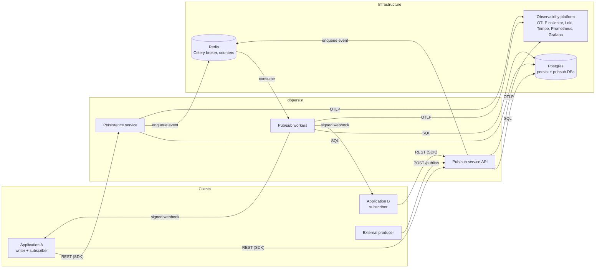
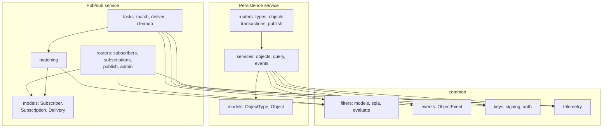
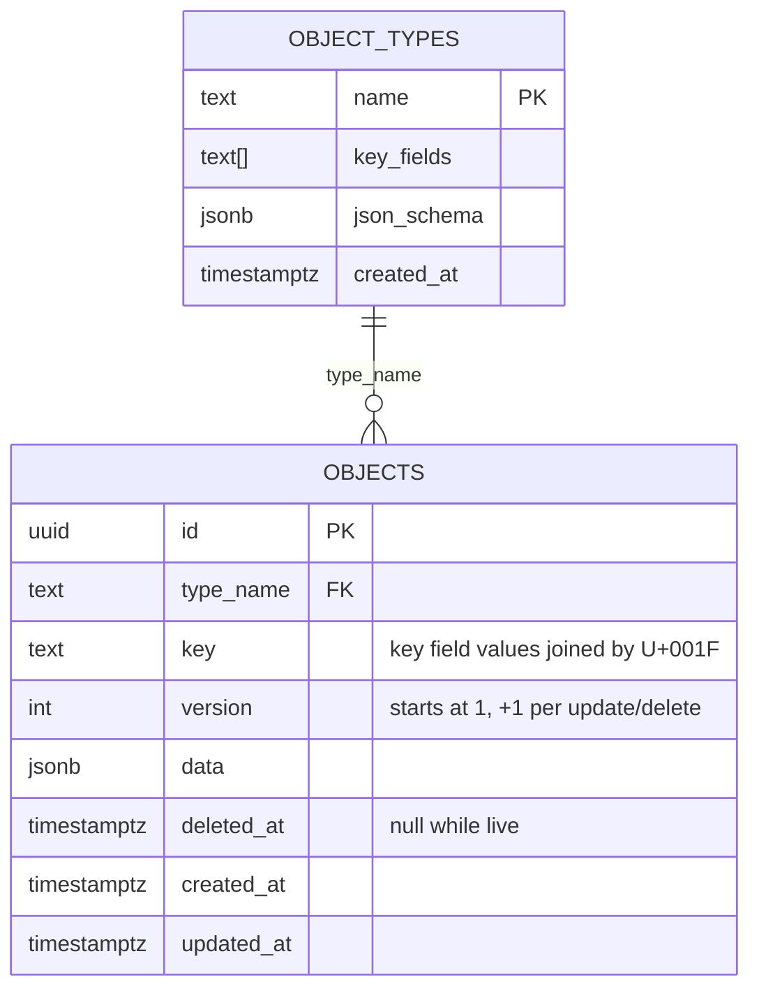
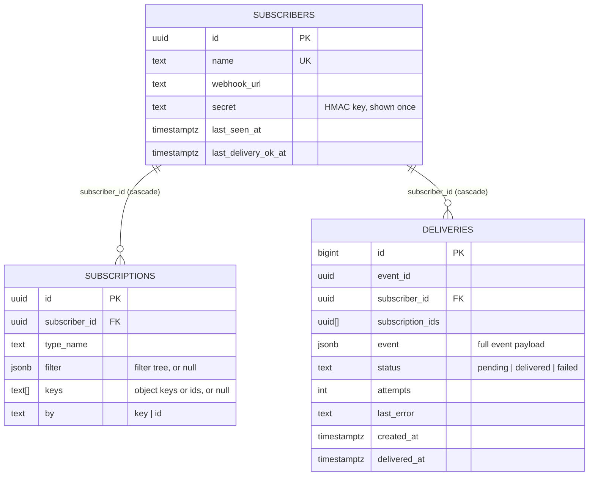
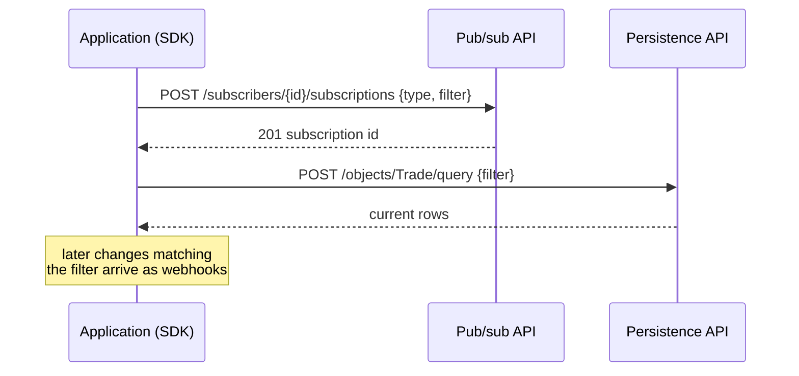
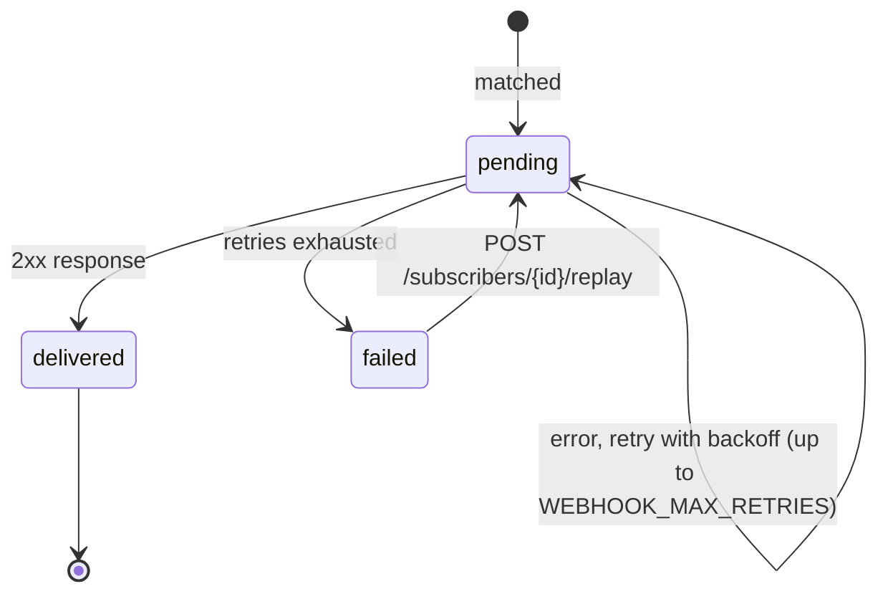
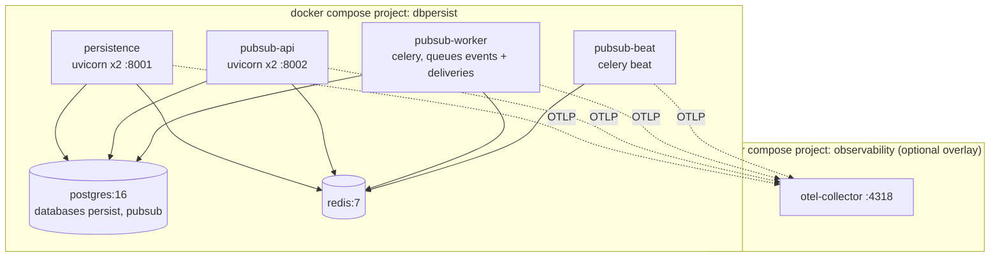

# dbpersist architecture

This document describes what dbpersist is made of, how data and control flow through it, the guarantees it offers, and the reasoning behind the main design choices. It is the reference for anyone evaluating, operating or extending the system. The [developer guide](DEVELOPER_GUIDE.md) covers code-level internals and day-to-day tasks; [TEST_CASES.md](TEST_CASES.md) lists the verification scenarios.

Contents

1. [Purpose and scope](#1-purpose-and-scope)
2. [System context](#2-system-context)
3. [Components](#3-components)
4. [Data model](#4-data-model)
5. [Key flows](#5-key-flows)
6. [Guarantees and semantics](#6-guarantees-and-semantics)
7. [Filter DSL](#7-filter-dsl)
8. [Security](#8-security)
9. [Observability](#9-observability)
10. [Deployment topology](#10-deployment-topology)
11. [Scaling and capacity](#11-scaling-and-capacity)
12. [Failure modes and recovery](#12-failure-modes-and-recovery)
13. [Design decisions](#13-design-decisions)
14. [Known limitations and future work](#14-known-limitations-and-future-work)

## 1. Purpose and scope

dbpersist gives applications two things that usually have to be built separately:

- **A persistence layer for typed, versioned business objects** without per-type schema work. An application registers an object type (a name, the fields that form its key, and optionally a JSON schema), then stores, queries and updates documents of that type. Every object carries a derived key and a monotonically increasing version used for optimistic locking.
- **Change notification.** Every committed insert, update or delete becomes an event. Other applications subscribe by a filter expression or by key and receive signed webhooks when matching changes happen, with retries, a delivery log, and replay.

Together they let a client *select* the current state and then *stay current* without polling: `active_select` returns the rows that match a criterion and subscribes to future changes that match the same criterion.

Out of scope: multi-region replication, a query language beyond the filter DSL (no joins or aggregates), per-tenant isolation beyond what the caller encodes in its data, and any user interface.

## 2. System context



Clients talk to dbpersist over HTTP with a static API key. dbpersist talks back to clients only through webhooks. Everything emits logs, traces and metrics over OTLP to an external observability platform; dbpersist contains no telemetry storage of its own.

## 3. Components

| Component | Package | Runtime | Responsibility |
|---|---|---|---|
| Persistence service | `packages/persistence` | FastAPI on uvicorn, SQLAlchemy 2 async with asyncpg | Object types, versioned JSONB objects, criteria queries, keyset paging, atomic multi-object transactions, publish-only events. Emits one event per committed change. |
| Pub/sub API | `packages/pubsub` | FastAPI on uvicorn | Subscriber registration and secrets, subscriptions, event ingress from external producers, replay, admin and health endpoints. |
| Pub/sub workers | `packages/pubsub` | Celery on Redis | Match events to subscriptions, record deliveries, POST signed webhooks with retries, housekeeping (idle subscribers, delivery retention). |
| SDK | `packages/sdk` | Python library (httpx, FastAPI router) | Typed client for both services, nested transactions, identity cache, callback dispatch from a webhook receiver. |
| Common | `packages/common` | Python library | Filter DSL with SQL and in-memory evaluators, event model, key derivation, HMAC signing, API-key dependency, logging and OpenTelemetry setup. |

The two services share nothing at the code level except `common`, and nothing at the data level except the Redis queue. Persistence does not import pub/sub; it enqueues a Celery task **by name**. That boundary is what allows the services to be deployed, scaled and restarted independently.

### Internal structure



## 4. Data model

### Persistence database (`persist`)



Indexes: a **partial unique index** on `(type_name, key) WHERE deleted_at IS NULL` enforces key uniqueness among live objects and lets a key be reused after deletion; a **GIN index** on `data` (`jsonb_path_ops`) serves equality filters through containment; a B-tree on `(type_name, updated_at, id)` backs keyset paging.

One table holds every type. Types differ only in their key fields and optional schema; the service validates documents against the schema at write time. The alternative, a table per type, was rejected because it reintroduces DDL on every type registration and splits the query path per type without a performance need at this scale.

### Pub/sub database (`pubsub`)



A CHECK constraint guarantees that a subscription is either a filter subscription or a key subscription, never both or neither. Deliveries store the complete event so a replay needs nothing from the persistence database.

### The event

```json
{
  "event_id": "uuid", "occurred_at": "ISO-8601",
  "type_name": "Trade", "object_id": "uuid or null", "key": "T1",
  "op": "insert | update | delete", "version": 3,
  "data": { "...": "post-image, or last image for delete" },
  "changed_fields": ["qty"],
  "transaction_id": "uuid or null"
}
```

`changed_fields` lists the top-level attributes whose value differs between the previous and the new document, so subscribers can react to specific attribute changes without diffing. `object_id` is null for publish-only events, which never touched the database.

## 5. Key flows

### Write, match, deliver

```mermaid
sequenceDiagram
    autonumber
    participant App as Application (SDK)
    participant P as Persistence API
    participant DB as Postgres (persist)
    participant R as Redis
    participant W as Pub/sub worker
    participant PDB as Postgres (pubsub)
    participant Rcv as App webhook receiver

    App->>P: PATCH /objects/Trade/{id} {version: 2, data: {qty: 160}}
    P->>DB: SELECT ... FOR UPDATE; check version == 2
    P->>DB: UPDATE data, version = 3; COMMIT
    P->>R: send_task("pubsub.publish_event", event)
    P-->>App: 200 {version: 3, ...}
    R->>W: publish_event(event)
    W->>PDB: SELECT subscriptions WHERE type_name = 'Trade'
    Note over W: evaluate filters in memory,<br/>group matches per subscriber
    W->>PDB: INSERT deliveries (pending) ; COMMIT
    W->>R: deliver_webhook(delivery_id) per subscriber
    R->>W: deliver_webhook(delivery_id)
    W->>Rcv: POST webhook, HMAC signature, traceparent
    Rcv-->>W: 200
    W->>PDB: UPDATE delivery status = delivered
    Note over Rcv: verify signature,<br/>call on_update(record, ["qty"])
```

The database commit happens **before** the enqueue, and the enqueue happens before the HTTP response. A failure between commit and enqueue leaves a committed write without an event; the API reports this as a 502 so the caller knows, and replay through the pub/sub API is the recovery path. The design accepts this narrow window rather than paying for a transactional outbox at this scale (see §14).

### Active select



The SDK subscribes first and queries second. A change that lands between the two calls is therefore delivered as a webhook even if the query already returned it; the receiver reconciles by version, which is why every record and event carries one.

### Delivery retry



Backoff is exponential with jitter and capped (`WEBHOOK_BACKOFF_MAX_SECONDS`). A receiver that returns 2xx has accepted the event; the SDK receiver returns 200 even when an application callback raises, reporting the exception through `on_error`, because retrying an application bug would only repeat it.

### Transaction

A transaction is a single HTTP request carrying an ordered list of insert, update and delete operations. The service applies them in one database transaction with row locks and version checks, commits once, and only then publishes the events, all stamped with the same `transaction_id`. If any operation fails, nothing is written and nothing is published. The SDK's nested `begin()` blocks are a client-side convenience that collect operations until the outermost block exits.

## 6. Guarantees and semantics

| Property | Guarantee |
|---|---|
| Write atomicity | Single-object writes and multi-op transactions are atomic in Postgres. |
| Concurrency control | Optimistic: every update and delete carries the version the caller read; a mismatch is rejected with the current version and nothing changes. |
| Key uniqueness | Enforced by the database among live objects of a type. |
| Event emission | At-least-once relative to commits, except the commit-then-enqueue window described in §5, which is surfaced as a 502. |
| Event ordering | Events for one object are produced in version order. Delivery order to a subscriber is **not** guaranteed under retries or parallel workers; consumers must use `version` to discard stale updates. |
| Delivery | At-least-once per matching subscriber. A subscriber with several matching subscriptions receives one webhook listing all matching subscription ids. Duplicate deliveries are possible after worker crashes (Celery acks late), so receivers should treat `event_id` as an idempotency key. |
| Delivery durability | Every delivery is a database row before the first POST; failed deliveries remain replayable for `DELIVERY_RETENTION_DAYS`. |
| Authentication | Static API key on every API call; HMAC-SHA256 over timestamp and body on every webhook, with a 5-minute replay window. |
| Read consistency | Queries read committed data from the primary; there are no replicas in the design. |

## 7. Filter DSL

One expression language serves three places: query predicates in persistence, subscription criteria in pub/sub, and client-side helpers in the SDK.

```json
{"and": [
  {"field": "qty", "op": "gt", "value": 100},
  {"or": [{"field": "book", "op": "like", "value": "ALP%"}, {"field": "book", "op": "is_null"}]}
]}
```

- A **clause** is `{field, op, value}`; **and** / **or** nodes nest arbitrarily.
- Operators: `eq ne lt le gt ge like not_like is_null is_not_null in`.
- `field` is a dotted path into the document (`leg.qty`); five reserved names address the object's own columns (`id`, `key`, `version`, `created_at`, `updated_at`).
- Strings tagged `value_type: "datetime"` compare as timestamps; `"bytes"` compares base64 payloads.

Two evaluators implement it. `to_sqla` translates a tree into a SQLAlchemy expression over the JSONB column, casting numbers to `numeric` and booleans to `boolean`, and adding a JSONB containment predicate on equality so the GIN index applies. `matches` evaluates the same tree against a Python dict for the matcher, with missing paths treated as null and type mismatches evaluating false. A parity test runs every operator through both and requires identical row sets, which keeps "what you can query" and "what you can subscribe to" the same by construction.

## 8. Security

- **API access**: a single shared `X-API-Key` for both services, intended for service-to-service use behind a private network or gateway. There is no per-user identity and no authorization model inside dbpersist.
- **Webhooks**: each subscriber gets a random 256-bit secret at registration, returned once. Every delivery is signed `sha256=HMAC(secret, "<unix ts>.<body>")` with the timestamp in a header; receivers reject bad signatures and timestamps older than five minutes. The SDK receiver implements this check.
- **Data**: documents are stored as given; dbpersist performs no encryption at rest beyond what Postgres provides. Secrets are stored in plaintext in the pub/sub database and should be protected at the database level.
- **Transport**: the services speak plain HTTP; TLS termination is expected at an ingress or sidecar.
- **Input validation**: Pydantic validates every request body; object documents are validated against the type's JSON schema; filter trees are validated before being stored or executed, so arbitrary SQL can never reach the database.

## 9. Observability

Every process initialises the same telemetry module at startup.

- **Logs** are structured JSON on stdout, one object per line, with `trace_id` and `span_id` injected when inside a span. Domain events and deliveries log with stable field names (`event_id`, `type_name`, `op`, `object_key`, `delivery_id`, `subscriber`, `attempt`, `duration_ms`). A middleware logs one line per HTTP request; health probes are excluded.
- **Traces** come from automatic instrumentation of FastAPI, SQLAlchemy, httpx and Celery. Context propagates through HTTP headers and Celery message headers, so a single trace spans the SDK call, the persistence request, the queue hop, the worker's matching and database work, and the webhook POST to the subscriber.
- **Metrics** are OpenTelemetry counters and histograms: events emitted by type and op, events received, deliveries created, delivered and failed, delivery attempts by outcome, and delivery round-trip latency, plus the standard HTTP server and database client series.
- **Health**: `/health` (liveness) and `/healthz` (readiness: database for persistence; database and broker for pub/sub).

Export is over OTLP/HTTP to whatever collector `OTEL_EXPORTER_OTLP_ENDPOINT` names. The repository ships a compose overlay that joins the observability platform's network and sets per-process service names.

## 10. Deployment topology



All Python services build from one image (`uv sync --frozen` of the workspace) and differ only in their command. Each API container runs `alembic upgrade head` for its own database before starting. Host port mappings are offset (5442, 6389, 8101, 8102) to coexist with other local stacks. For development the services can run from source against the Postgres and Redis containers; on Windows the Celery worker must use the threads pool.

Nothing in the design is Docker-specific: the same four processes run under any orchestrator given a Postgres, a Redis, and the environment variables listed in the developer guide.

## 11. Scaling and capacity

Scaling dimensions, from most to least elastic:

1. **Pub/sub workers** scale horizontally; each container consumes the shared queues independently. Matching reads only the subscriptions of the event's type, so cost per event is proportional to subscriptions on that type, not total subscriptions. Delivery work is I/O-bound (database round trips and the subscriber's HTTP latency), so worker containers idle on CPU and benefit from higher per-container concurrency.
2. **API containers** scale horizontally behind any load balancer; they hold no state between requests.
3. **Postgres** is the shared ceiling. Write load is single-row inserts and updates plus one delivery row per matching subscriber per event. Fan-out multiplies delivery rows, so the practical event rate is the raw rate divided by the average number of matching subscribers.
4. **Redis** carries small task messages and is far from saturation at any rate the other tiers can reach.

A load probe run inside the Docker network on a developer laptop, with one worker container of eight prefork processes and 20 filter subscriptions on the type, measured about 190 events/s accepted by the pub/sub API, 135 writes/s accepted by persistence, 90 deliveries/s sustained end to end, and roughly 110 ms unloaded latency from publish to webhook, with no failures. The worker was latency-bound, not CPU-bound. The developer guide's performance section tracks the current figures and the tuning applied since.

## 12. Failure modes and recovery

| Failure | Effect | Recovery |
|---|---|---|
| Postgres (persist) down | Persistence writes and reads fail; `/healthz` reports database down. Pub/sub continues delivering already-queued events. | Restore the database; no data loss for committed writes. |
| Postgres (pubsub) down | Workers cannot record or update deliveries; tasks fail and Celery retries them; the API cannot register or subscribe. | Restore; queued tasks resume. Events remain in Redis until processed. |
| Redis down | Persistence writes still commit but the enqueue fails and the API returns 502; workers idle. | Restore Redis; replay events for the affected window via `POST /subscribers/{id}/replay` once deliveries exist, or re-publish from the producer. |
| Worker crash mid-task | Celery acknowledges late, so the task is redelivered to another worker. A webhook that was sent but not recorded may be sent twice. | Receivers de-duplicate on `event_id`. |
| Subscriber endpoint down | Deliveries to that subscriber retry with backoff, then mark `failed`; other subscribers are unaffected. Admin views show pending and failed counts per subscriber. | Fix the endpoint, then replay. |
| Subscriber silently gone | No heartbeats and no successful deliveries past `IDLE_SUBSCRIBER_MINUTES`. | The beat job removes the subscriber and its subscriptions; deliveries cascade. |
| Observability platform down | Exporters buffer briefly, then drop; services are unaffected. Logs remain on stdout. | None required. |
| Bad deploy of a filter change | Caught by the parity test before merge. | Revert. |

## 13. Design decisions

| Decision | Alternatives considered | Why this one |
|---|---|---|
| Single JSONB table with a type registry | Table per type; EAV | No DDL at runtime, one query path, GIN index covers equality; types are many and small. |
| Optimistic locking by version | Pessimistic row locks held across requests; last-writer-wins | Stateless HTTP cannot hold locks; version checks make conflicts explicit and cheap. |
| Soft delete | Hard delete | Delete events need the last image; keys must be reusable; retention is a later concern. |
| Events after commit, enqueued by task name | Transactional outbox; synchronous HTTP to pub/sub | No import coupling, no second hop on the write path, durable queue; the small commit-to-enqueue gap is surfaced as 502. |
| Celery on Redis for fan-out | Direct HTTP from persistence to subscribers; Kafka | Durable retries, backoff and horizontal workers for the price of a Redis; Kafka's ordering and retention were not required. |
| Subscriptions loaded per event by type | In-memory subscription index with cache invalidation | Simplest correct design across many worker processes; the per-type index keeps the query small. |
| One webhook per subscriber per event | One per subscription | Avoids duplicate processing in the receiver; the payload lists all matching subscription ids. |
| HMAC-signed webhooks | mTLS; bearer tokens in the URL | Works with any receiver, no certificate management, replay-bounded by timestamp. |
| Shared static API key | OAuth2 / JWT | Service-to-service deployment behind a gateway; keeps the surface small. Swappable in one dependency. |
| Sync SQLAlchemy in workers, async in APIs | Async everywhere | Celery prefork and asyncio do not mix; the two engines share the ORM models. |
| JSON filter DSL instead of a text grammar | SQL fragments; a custom parser | Validated by Pydantic, safe to store and execute, trivially translatable to SQL and to in-memory checks. |

## 14. Known limitations and future work

- **Outbox.** The commit-then-enqueue gap is reported but not self-healing. A transactional outbox table drained by a relay would make event emission exactly-once relative to commits.
- **Ordering.** Per-subscriber ordering under retries would need per-subscriber serialisation (one queue or lock per subscriber) at a throughput cost.
- **Matching cost.** Filters are parsed per event; caching parsed trees per subscription reduces matching to a few microseconds per subscription. Delivery throughput per worker is bounded by sequential I/O per process; an I/O-concurrent pool or inline delivery for single-subscriber events raises it substantially. Both are in progress.
- **Authorization.** There is no per-tenant or per-type access control; all callers with the key see all data.
- **Schema evolution.** JSON schemas are validated on write but there is no migration tooling for existing documents when a schema changes.
- **Query expressiveness.** No joins, aggregates or full-text search; `expand` follows single-level references only.
- **Multi-region.** Single Postgres primary and single Redis; no geo-distribution.
